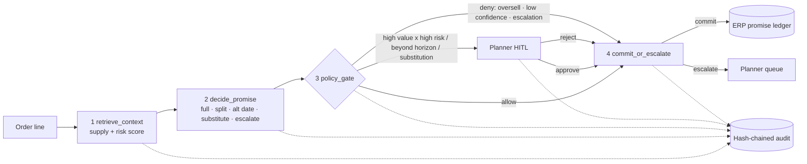

# Demand-Aware Order Promising: a governed, risk-aware ATP workflow

> Reference pattern 4 in an applied enterprise-AI / ERP portfolio. **A deliberately simple four-step workflow, not an agent swarm** ([ADR-0005](docs/adr/0005-workflow-is-sufficient.md)). **All results are SYNTHETIC** and generated from public dataset *schemas*; no real company data is used.

## The problem (30 seconds)
Classic available-to-promise (ATP) treats inbound supply as certain. When a supplier slips, the customer learns about the backorder *after* the promise was made. That costs re-promise effort, expediting, OTIF penalties, and trust. Order-management teams need promises that **price in supply risk**, and they need every promise to stay **controlled and auditable**, because a promise date is a customer commitment.

## The pattern
Each order line goes through four fixed steps:
1. **retrieve_context** reads projected on-hand and inbound supply and scores **backorder risk per SKU** with an explainable model.
2. **decide_promise** applies a decision table: **full**, **partial split**, **alternate date**, **substitution**, or **escalation**. Risk buffers move supply-dependent dates.
3. **policy_gate** runs default-deny policy-as-code, with **planner approval (HITL)** inside the gate where the policy requires it. It never writes.
4. **commit_or_escalate** writes the promise to the ERP-style ledger only with a passing verdict. Otherwise the line goes to the planner queue.

**Every step is hash-chain audited.**



## Why a workflow is enough
Every step works on the same order line, the same supply position, and one risk score. The promise choice is a bounded decision table, and a promise date is a customer commitment. Agents, or an LLM in the loop, would add cost and tail latency on a path that runs inline with order entry, and would add more ways to break a commitment, with no better decisions in return. The fixed workflow is **cheaper, faster, deterministic, and easy to govern and evaluate**: one gate, one write path, and a test asserts every commit or escalation follows a policy decision. [ADR-0005](docs/adr/0005-workflow-is-sufficient.md) names the conditions that would change this, such as multi-plant allocation, unstructured supplier inputs, or iterative what-if planning.

## Value framing (KPIs an ERP program would track)
| KPI | Why it matters | Lever in this pattern |
|---|---|---|
| OTIF / on-time-in-full | Customer SLA, penalties | Risk buffers, split shipments |
| Backorder-surprise rate | Re-promise workload, churn | Risk-aware dates, substitution |
| Quoted lead time | Win rate, competitiveness | Buffer coefficient (tunable trade-off) |
| Touchless promise rate / approval rate | Planner capacity | Policy thresholds (P4–P6) |
| Audit completeness | SOX-style control, dispute resolution | Gate-then-commit + hash chain |
| Cost and latency per promise | Runs inline with order entry | Deterministic workflow, no model calls in the decision path |

## Results (SYNTHETIC, seed 42, 1,500 order lines, same simulated world for both policies)
| Metric | Naive ATP | Risk-aware governed ATP |
|---|---|---|
| OTIF proxy | 0.514 | **0.792** |
| Backorder-surprise rate (>3 days late) | 0.302 | **0.122** (−60%) |
| Mean abs promise-date error (days) | **5.33** | 5.90 |
| Mean promised lead time (days) | **12.2** | 15.9 |
| Lines escalated to planner | – | 3.7% |
| Lines routed to HITL approval | – | 9.9% (149 approved, 0 rejected) |
| Audit hash chain valid | – | ✅ 9,149 records |

Risk model (logistic regression, 30% holdout of synthetic SKUs): AUC 0.84, precision 0.50, recall 0.76 at 0.5. **Honest read:** the workflow trades about 3.7 days of quoted lead time for far fewer late surprises. Absolute date error rises slightly because buffered orders often arrive early. Details are in [docs/results.md](docs/results.md).

## Lessons learned (ERP-implementer view)
1. **Risk-aware promising is a policy decision, not a model decision.** The buffer coefficient decides between speed and reliability, so sales and customer service must own it per segment.
2. **Explainability beats a few AUC points.** Planners accept a moved date when the audit shows "supplier perf gap + low coverage". They push back on an opaque score.
3. **Put the gate at the commit, not in the prompt.** Gate and commit are separate steps, and `commit()` refuses without a passing verdict. Oversell and low-confidence promises are blocked by code (P2/P3), whatever the proposer does.
4. **HITL volume is a design parameter.** With these thresholds ~10% of lines need review. Tune P4/P5 to planner capacity before go-live.
5. **Measure against a simulated "actual".** Promise quality only shows when it's scored against realised fulfillment. Baseline and workflow must face the same world.
6. **Start with the simplest architecture that meets the control requirements.** A four-step workflow gave the same promise results as the v0.1 "agent graph" framing, with a clearer audit story.
7. **Calibrate on real data first.** The synthetic backorder base rate is 24% versus ~0.7% in the public data, so thresholds will move.

## How to run
```bash
python -m venv .venv && . .venv/bin/activate && pip install -r requirements.txt
PYTHONPATH=src python -m dop.demo     # -> out/results.md, results.json, audit.jsonl (make demo also works)
python -m pytest -q                    # 29 tests (make test)
PYTHONPATH=src:../agentic-governance-control-plane/src python -m pytest -q   # same, with agcp adapter live
PYTHONPATH=src python -m dop.demo --engine fallback      # no LangGraph needed
```
Real data: see [docs/data.md](docs/data.md) (`--backorder-csv`, `--olist-csv`).

## Repository layout
```
src/dop/        data.py (generators+loaders) · risk.py · atp.py · governance.py (gate/commit) · graph.py (4-step workflow) · demo.py
src/dop/adapters/agcp_adapter.py   optional bridge to the governance control plane
docs/adr/       0001 graph (superseded) · 0002 explainable model · 0003 buffers & promise types · 0004 local governance · 0005 workflow is sufficient
docs/diagrams/  component · sequence (policy gate + HITL) · promise decision flow
docs/data.md · docs/results.md · data/sample/*_SYNTHETIC.csv · scripts/ · tests/
```

## Relationship to the governance control plane
Governance here is **self-contained**: `dop/governance.py` defines `PolicyGate`, `AuditSink`, and `Approver` interfaces with minimal local implementations. They mirror the patterns of [agentic-governance-control-plane](https://github.com/padmanpisupati/agentic-governance-control-plane): default-deny policy-as-code, hash-chained audit, approval tiers, and compensating rollback. `dop/adapters/agcp_adapter.py` optionally mirrors audit events into `agcp.AuditLog` when that library is installed. Its tests pass with the control-plane source on `PYTHONPATH` (see ADR-0004).

## Data citation
- Product backorders: Kaggle, `gowthammiryala/back-order-prediction-dataset`. https://www.kaggle.com/datasets/gowthammiryala/back-order-prediction-dataset
- Brazilian E-Commerce Public Dataset by Olist: Kaggle, `olistbr/brazilian-ecommerce` (CC BY-NC-SA 4.0). https://www.kaggle.com/datasets/olistbr/brazilian-ecommerce

Only the schemas are used. Committed samples are SYNTHETIC, and loaders for the real files are included.

MIT License. Reference implementation, not production advice.
